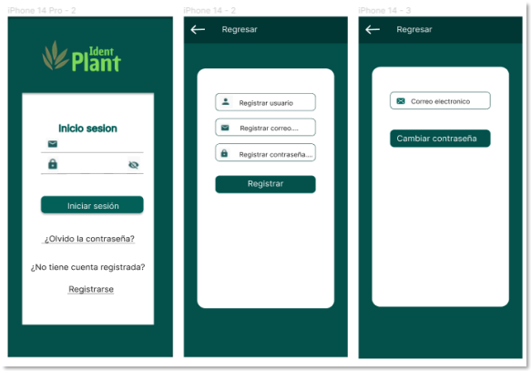
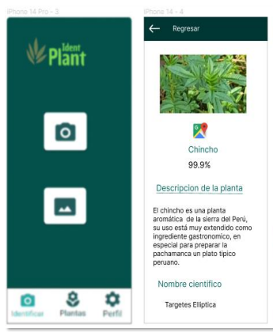
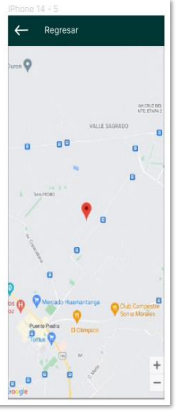

# 🌿 IdentPlant - Identificación de Plantas con Inteligencia Artificial

IdentPlant es una aplicación móvil multiplataforma desarrollada en Flutter que utiliza un modelo de Inteligencia Artificial (Redes Neuronales) para identificar especies vegetales a través de fotografías en tiempo real. 

El software cuenta con **Derechos de Autor Registrados ante INDECOPI (Perú)**.

---

## 📱 Capturas de Pantalla

| Inicio de Sesión | Identificación y Detalles | Geolocalización |
| :---: | :---: | :---: |
|  |  |  |
| *Sistema de autenticación.* | *Predicción (99.9%) y ficha médica.* | *Mapa con ubicación del hallazgo.* |

---

## ✨ Características Principales

*   **Autenticación Segura:** Registro e inicio de sesión para gestionar el perfil del usuario.
*   **Identificación con IA:** Uso de la cámara o galería para predecir la planta (matico, chincho, atajo) con un **99.9% de precisión**.
*   **Ficha Botánica:** Ficha técnica detallada con nombre común, nombre científico (*ej. Tagetes Elliptica*), descripción y propiedades medicinales.
*   **Geolocalización:** Registro en mapas de la ubicación exacta donde se identificó la planta.
*   **Historial:** Guarda un registro cronológico de todas las plantas identificadas por el usuario.

---

## 🛠️ Tecnologías y Arquitectura

*   **Frontend (Móvil):** Flutter, Dart.
*   **Inteligencia Artificial:** Python, Redes Neuronales (Entrenado con 1,500 imágenes y evaluado con matriz de confusión).
*   **Backend / Base de Datos:** Firebase (Autenticación y almacenamiento en la nube).
*   **APIs:** Geolocalización y mapas.

---

## ⚙️ Instalación y Ejecución Local

1. Clona este repositorio:
   ```bash
   git clone https://github.com/ZunildaRomero/identplants.git
